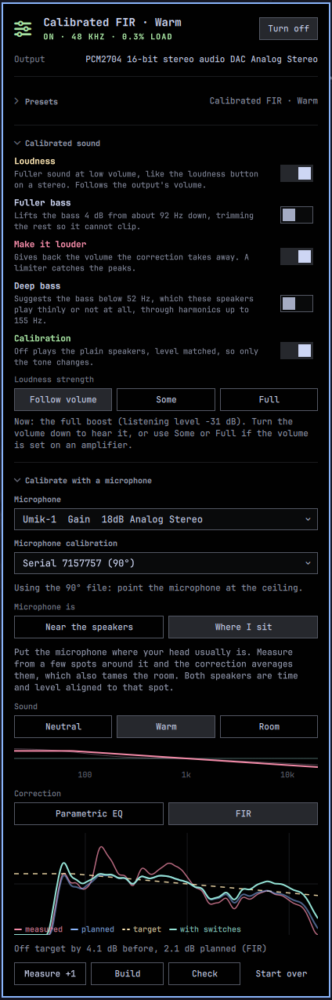

# CamillaDSP for Omarchy



Run every sound on your desktop through [CamillaDSP](https://github.com/HEnquist/camilladsp), switch presets from the bar, and calibrate your speakers or your room with a microphone: it plays sweeps, measures, fits the filters, and checks the result, all from the panel.

The aim is a real DSP engine that anyone can use to make their sound better, without having to learn one first. CamillaDSP is that engine; this plugin is the easy way in.

It stands on the shoulders of [Speaker Calibrator](https://github.com/thefreshoffice/omarchy-speaker-calibrator), which made measuring and correcting speakers from the Omarchy bar feel effortless, with a PipeWire filter-chain underneath. Putting CamillaDSP there instead opens up what a filter-chain makes awkward: separate correction per speaker, FIR (convolution) correction, delay and level alignment, averaging several microphone positions for room correction, measurement microphones with their calibration files, and presets you can write or import from REW and other tools. See [Thanks](#thanks) for more.

<br clear="right">

## Install

```bash
omarchy plugin add https://github.com/C622/omarchy-camilladsp.git --enable
```

Adding the plugin only copies it into `~/.config/omarchy/plugins/`; nothing runs until you ask. Click the sliders icon in the bar and press **Set up**. It opens a terminal, because installing packages may ask for your password:

- **CamillaDSP 4 with the PipeWire backend.** If one is already installed (an AUR package, say) and was built with `pipewire-backend`, it is used. Otherwise CamillaDSP 4.1.3 is built from source with cargo into `~/.local/bin`, pinned to that release's exact commit (a few minutes, once).
- `python-numpy` and `python-scipy` for the calibrator.
- Two systemd user services, `omarchy-camilladsp-sink` and `omarchy-camilladsp` (and `omarchy-camilladsp-loudness` once you use Loudness), plus a WirePlumber rule. All of the configuration is in your home folder; PipeWire is never restarted, and WirePlumber is restarted once to read its rule.

### Dependencies

| What | Why | Installed by |
|---|---|---|
| [CamillaDSP](https://github.com/HEnquist/camilladsp) 4.x, `pipewire-backend` | Does all the sound processing | Set up, built with cargo into `~/.local/bin` unless one is installed |
| `rust` (cargo), `clang`, `pkgconf`, `pipewire` | Building CamillaDSP (bindgen needs libclang) | Set up, from the Arch repositories, only when building |
| `python-numpy`, `python-scipy` | Measurement analysis and filter fitting | Set up, from the Arch repositories |
| `python`, `jq`, `pactl`, `pw-cli`, `pw-link`, `pw-play`, `pw-record` | Control, routing and measuring | Already part of Omarchy |

### Upgrading from 1.0.1 or earlier: one required step

Versions before 1.0.2 started CamillaDSP with its websocket open on a local port, with no authentication, so any other account on the machine could take control of it and overwrite your files. Newer versions start it without one. The panel replaces the old service and restarts CamillaDSP without the port as soon as it loads. But Omarchy runs no plugin code on update, so **if the CamillaDSP widget is not in your bar, nothing does this for you**. After updating, run this once:

```bash
~/.config/omarchy/plugins/c622.camilladsp/bin/camilladsp-omarchy status
```

To check, `ps -o args= -C camilladsp` must not show `--port`. If you don't want the plugin any more, [remove it](#removing-it) instead; `uninstall` stops and deletes the old service as well.

## Removing it

Turn CamillaDSP off and remove what Set up installed, then remove the plugin:

```bash
~/.config/omarchy/plugins/c622.camilladsp/bin/camilladsp-omarchy uninstall
omarchy plugin remove c622.camilladsp
```

`uninstall` points the default output back at your real device, stops and removes the services, the virtual sink and the WirePlumber rule. It keeps what you might want again: your presets and calibrations in `~/.config/camilladsp/`, measurements in `~/.local/state/omarchy-camilladsp/`, and the CamillaDSP build at `~/.local/bin/camilladsp`. Delete those by hand for a clean slate, and remove the packages with `omarchy pkg drop` if nothing else needs them.

## Using it

| In the bar | Does |
|---|---|
| Click | Open the panel |
| Right-click | Turn CamillaDSP on or off |
| Scroll | Next or previous preset |

**On** points the default output at a virtual **CamillaDSP** sink, moves playing apps onto it, and has CamillaDSP play the processed audio to the output that was selected before. Turn it on again after switching outputs (say, to headphones) and it follows. Volume keys keep controlling the real device, after the processing, so the DSP always sees the full signal.

If something switches the default output away from CamillaDSP, the panel says **Bypassed**: audio is going around the processing.

### Presets

Presets are CamillaDSP configs without the `devices` section, in `~/.config/camilladsp/presets/`, applied in file-name order. Six ship with the plugin: Flat, Bass boost, Vocal clarity, Treble lift, Laptop speakers and Headphone crossfeed. Each brings its own headroom so it cannot clip.

Write your own, or drop in a full config from elsewhere: any `devices:` block is replaced with the plugin's. Every preset is checked with `camilladsp --check` before it is applied, and a broken one is refused with CamillaDSP's error rather than half-applied.

## Calibrating

1. **Pick a microphone.** A measurement microphone at your seat gives the best result; a laptop's built-in one works for correcting the speakers themselves. Bluetooth headset microphones and empty jacks are listed but can't be used.
2. **Say where it is.** *Near the speakers* measures the speakers and keeps the room out (short windows). *Where I sit* measures what reaches you, room included, and also aligns both speakers in time and level to that spot.
3. **Measure.** About 30 seconds: a quiet level probe, then three sweeps per speaker. Keep quiet. With the microphone at your seat, move it a little and press **Measure +1** a few times: positions are averaged, so the correction fixes what is true across your head's movements rather than one point in space.
4. **Build.** Choose a sound (**Neutral**, **Warm**, or **Room**, a gentle in-room curve with more bass) and a correction (**Parametric EQ** or **FIR**). The strip under Sound shows the three targets, and the graph previews what the chosen combination would do before anything is saved. Build fits it, saves it as a preset named after the combination, such as *Calibrated EQ · Neutral*, and turns it on. Every combination gets its own preset, so build a few and switch between them, or back to *Flat*, in the preset list. Rebuilding a combination replaces only that one.
5. **Check.** Plays the sweeps through CamillaDSP and measures what actually comes out, against the target and against what was planned.

### The switches

When a calibrated preset is playing, the panel shows five switches under **Calibrated sound**. They apply to every calibrated preset, which is rewritten from its saved fit, so switching is instant and nothing has to be measured again.

| Switch | What it does |
|---|---|
| **Loudness** | Fuller sound at low volume, like the loudness button on a stereo. A small service follows the output's own volume; as you turn down, the plugin writes a bass and a treble shelf into the config and has CamillaDSP reload it, which changes the gains without interrupting the sound. It lowers the mids rather than boosting the ends, so it can't clip after the volume control. If you set the volume on an amplifier, the output stays at full and there is nothing to follow: pick **Some** or **Full** under *Loudness strength* instead of *Follow volume*. The panel shows how much of the boost is applied right now. |
| **Fuller bass** | A +4 dB low shelf just above where the speakers give up (twice the high-pass corner, 60 to 200 Hz), paid for by a 4 dB input trim so the added bass cannot clip, the way the Speaker Calibrator's *Bass: Full* works. |
| **Make it louder** | Gives back the volume the correction takes away, up to 6 dB, plus Fuller bass's trim, with a limiter at −1 dBFS to catch peaks. |
| **Deep bass** | Suggests the bass the speakers play thinly or not at all. What lies below where they are about 6 dB short of the target is driven into a clipper, and the harmonics between that point and three times it are mixed back ahead of the EQ, the bankstown recipe built from CamillaDSP's own mixers, biquads and limiter. Only offered when the measurement found a bass limit. |
| **Calibration** | Off plays the plain speakers, level matched to the calibration, so only the tone changes. |

### Microphone calibration files (UMIK-1 and friends)

Measurement microphones come with a calibration file describing their own small errors. Download yours (miniDSP names UMIK files by serial number) into `~/Downloads` or `~/.config/camilladsp/mic-calibration/`. The panel then offers it under **Microphone calibration**. It remembers which file goes with which microphone and applies it to every measurement and check.

miniDSP supplies two files: the **0°** one for a microphone pointed at the speakers, and the **90°** one for a microphone pointed at the ceiling, which is the usual way to measure at the listening position. The panel reminds you which one is in use.

From the command line:

```bash
camilladsp-omarchy calibrate mic-cal --mic <source-name> --file ~/Downloads/7103946_90deg.txt
```

miniDSP's format (the `"Sens Factor =…, SERNO: …"` header) and REW-style `.txt`, `.cal` and `.frd` files are read, with or without a phase column.

### How the measurement works

- **Exponential sine sweeps**, 10 Hz to 22 kHz, left and right separately, three each. The transfer function comes from regularized spectral division by the exact digital sweep, so latency doesn't matter and the arrival time of each speaker is kept.
- **Frequency-dependent window** of 15 cycles: long at low frequencies, short at high ones. Near the speakers it is capped at 300 ms; at the listening position at 500 ms, so room modes are included and can be corrected.
- **Noise floor** from the second of silence before the sweeps, put through the same deconvolution, gives the SNR at every frequency. Where the floor is close, or where the repeats disagree, corrections are trusted less.
- **Refuses rather than guesses**: a clipping microphone, a room too loud for the sweeps, a microphone that heard nothing, a muted output or microphone, or another app playing all stop the measurement with a message.

### How the filters are fitted

- **Protective high-pass** where the speaker gives up (12 dB short of target below 400 Hz). The EQ works only above where the speaker is within 6 dB, so it never fights the roll-off.
- **Cuts first.** A remaining peak counts more than a remaining dip, because a dip is often a cancellation that moves with your head. Boosts are priced by the cone travel they cost, so a boost an octave above the knee is expensive and one in the treble is cheap.
- **Greedy plus joint refinement.** Each step tries the strongest few separate problems, then re-optimizes every filter's frequency, gain and Q together.
- **Cross-validation.** A filter has to improve each repeat on its own, not only their average, or it is removed.
- **Budget**: at most −12 dB per filter and +6 dB of boost, at most −15/+6 dB of total correction at any frequency, and a preamp that keeps the loudest corrected frequency 0.5 dB below full scale.
- **FIR mode** turns the same smoothed correction into an 8192-tap minimum-phase filter per channel (CamillaDSP `Conv`). It fills dips only halfway and fades out past the measured band.

Click **Presets**, **Calibrated sound** or **Calibrate with a microphone** to fold that section away; it then shows just the current preset, the switches that are on, or the microphone in use, and stays folded the next time you open the panel.

## Hotkeys and IPC

```lua
-- ~/.config/hypr/bindings.lua
o.bind("SUPER + ALT + E", "CamillaDSP on/off", "omarchy-shell c622.camilladsp togglePower")
o.bind("SUPER + ALT + PERIOD", "Next EQ preset", "omarchy-shell c622.camilladsp nextPreset")
```

The IPC target `c622.camilladsp` has `open`, `close`, `toggle`, `refresh`, `togglePower`, `nextPreset` and `prevPreset`.

Everything the panel does is also a command, in `bin/camilladsp-omarchy` inside the plugin folder:

```bash
camilladsp-omarchy on | off | toggle | status [--json]
camilladsp-omarchy preset <id|next|prev>
camilladsp-omarchy calibrate devices | measure | fit | apply | check | summary | reset
```

## Files

| Path | What |
|---|---|
| `~/.config/camilladsp/presets/` | Presets, yours to edit |
| `~/.config/camilladsp/omarchy.conf` | Optional overrides: `samplerate`, `chunksize`. |
| `~/.config/camilladsp/mic-calibration/` | Microphone calibration files and which microphone uses which |
| `~/.config/camilladsp/filters/` | FIR filters written by the calibrator |
| `~/.local/state/omarchy-camilladsp/` | Generated config, selected preset and output, measurements |

See [Removing it](#removing-it) for taking it all out again.

## Safety notes

CamillaDSP's two PipeWire streams are only ever allowed to connect where they were sent. When it turns on, the plugin pins the output to the real device and checks the links. Anything that would let CamillaDSP hear its own output, a feedback loop, is disconnected. The WirePlumber rule stops WirePlumber falling back to another device if the sink or the output disappears, so a vanished device means silence rather than a loop.

CamillaDSP runs without its websocket, so the plugin opens no network port. That websocket has no authentication, and any local account could reach it and load a config that writes to your files. Presets, switches and Loudness all work by writing the config and sending CamillaDSP a reload signal instead. Versions before 1.0.2 did open one; see [Upgrading from 1.0.1 or earlier](#upgrading-from-101-or-earlier-one-required-step).

## Development

```bash
test/run            # DSP tests on a simulated speaker and room, plus the panel's logic
```

The DSP tests build a speaker with known resonances, a desk reflection, a late room reflection, an inter-speaker delay and noise. They check that the analysis recovers it, that the fit corrects it at least as well as the exact inverse, and that the safety gates refuse clipping, silence and noisy rooms.

## Thanks

**[CamillaDSP](https://github.com/HEnquist/camilladsp)** by Henrik Enquist does all of the actual sound processing: the filters, the convolution, the mixers, the loudness compensation and the limiter, at low latency and low CPU, with a native PipeWire backend and a websocket for control. This plugin only measures, writes configs for it, and puts a panel in front of it. If you use it, consider supporting the project, and read its documentation: there is far more in it than this panel exposes. CamillaDSP is licensed GPL-3.0 or MPL-2.0; the plugin does not bundle it, it installs or builds it on your machine.

**[Speaker Calibrator](https://github.com/thefreshoffice/omarchy-speaker-calibrator)** by Michael de By is where the idea and the workflow come from: measure from the panel in thirty seconds, refuse a bad measurement rather than install it, protect the speakers with a high-pass, cut rather than boost, check the result. The sound switches follow its switches, in name and in spirit: Loudness, Make it louder, Deep bass and Calibration, with Fuller bass after its *Bass: Full*. If you have a laptop and want the simplest thing that works, use it. It is very good at that, and its README is a small education in measuring speakers properly. This plugin is written separately and shares no code with it; it is the same goal, aimed at desktop speakers, measurement microphones and rooms, and built on a full DSP engine.

**bankstown**, the bass enhancer James Calligeros wrote for Asahi Linux, is the recipe behind Deep bass: saturate what the speaker cannot play, and add back the harmonics it can.

## License

MIT
